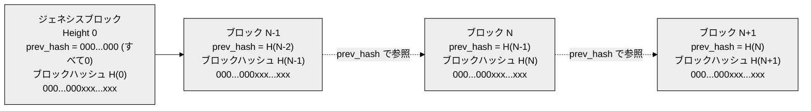
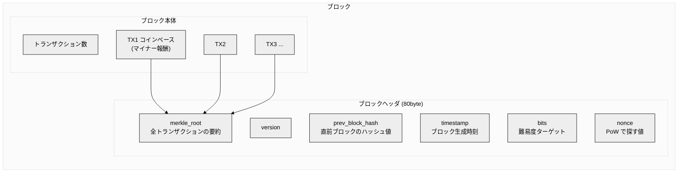
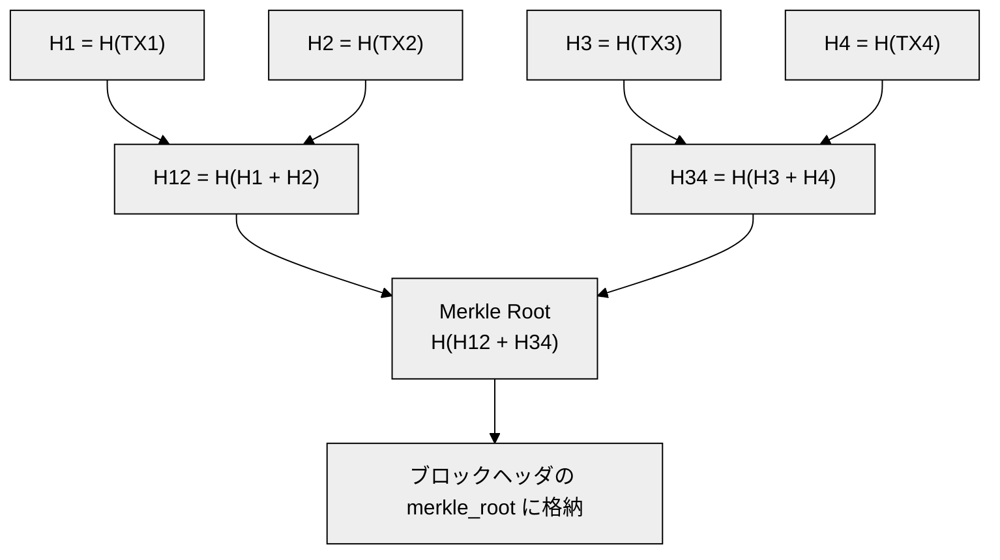
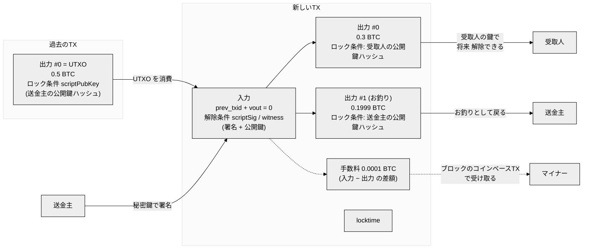
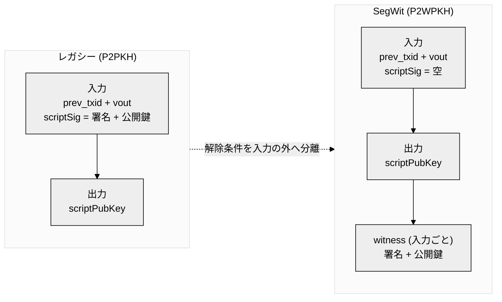
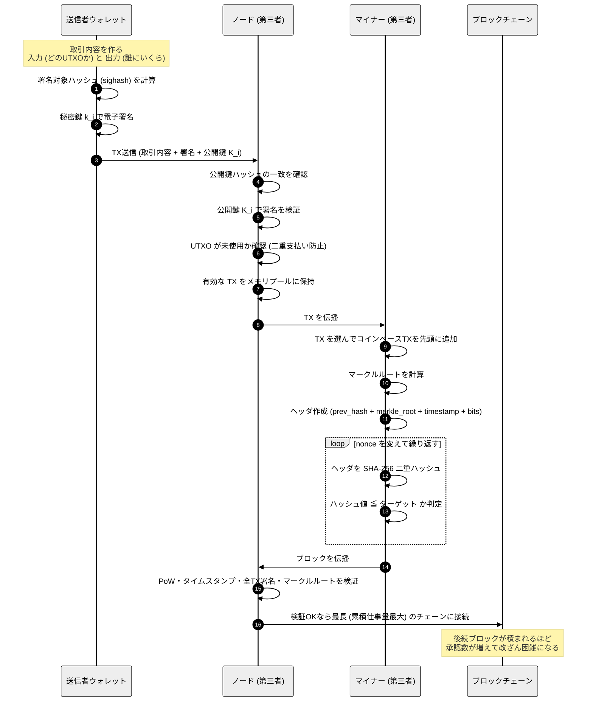
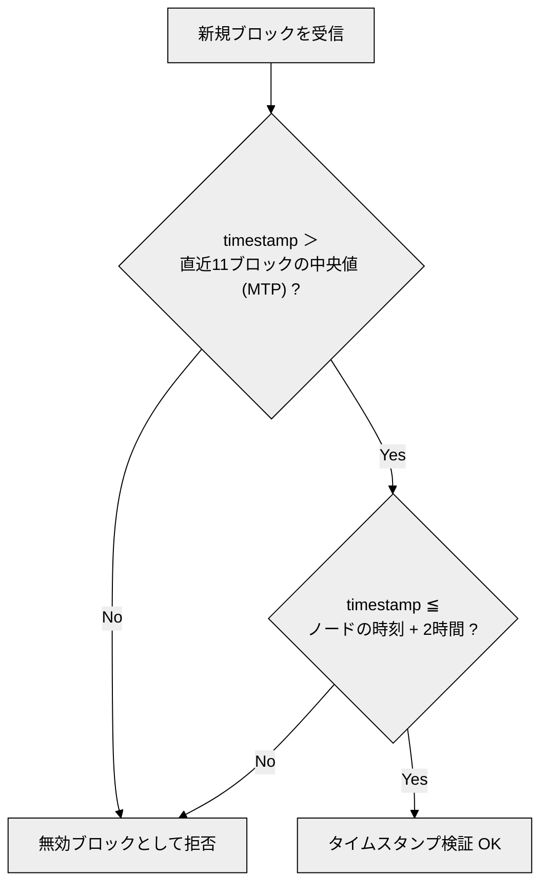
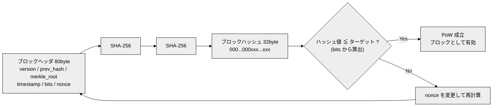
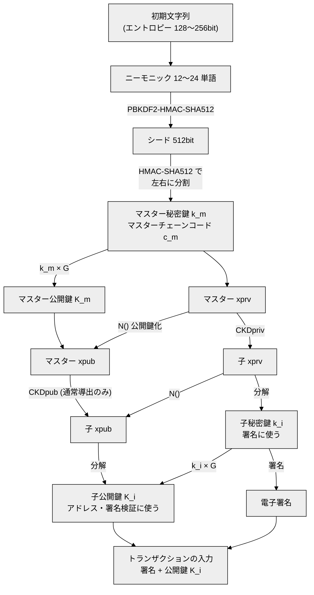
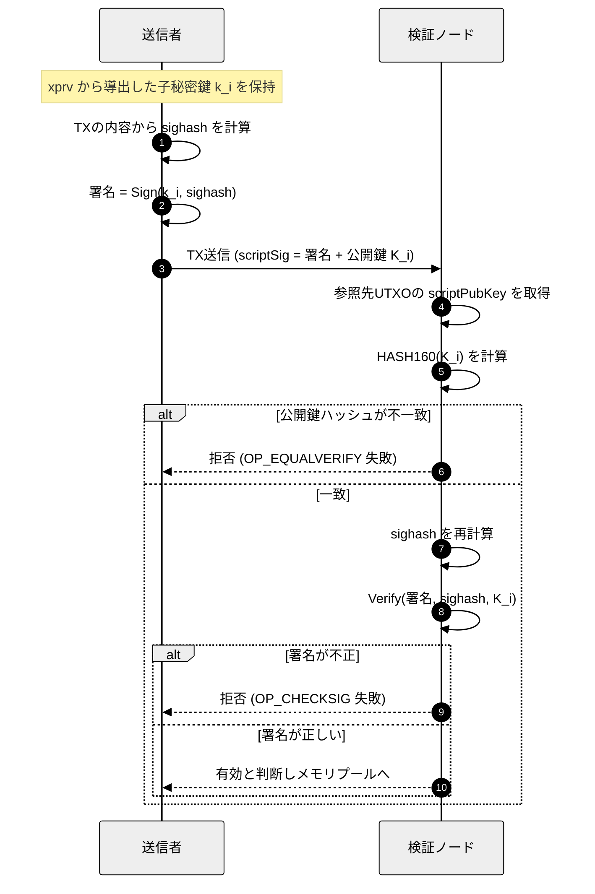

# ビットコイン

## 概要

* ビットコインのブロックチェーンは**分散型台帳**
* 今までの取引内容がすべて書かれた台帳で、世界中のノードが同じ写しを持つ
* 取引(トランザクション)は**電子署名**で「持ち主本人が出した」ことを証明する
* 取引はブロックにまとめられ、各ブロックは**直前のブロックのハッシュ値**を持って鎖状につながる
* ブロックの追加は**Proof of Work**(ハッシュ計算の競争)で決まり、特定の管理者(第三者)を必要としない
* ブロックには**タイムスタンプ**があり、取引がいつ確定したかの目安になる
* 過去のブロックを改ざんするとハッシュ値が変わり、以降のブロックとの整合性が崩れる

---

## ブロックチェーン



> 実体としては、新しいブロックが古いブロックのハッシュ値を参照する(後ろ向きのポインタ)。

#### ブロックハッシュの見た目

ブロックハッシュは、先頭に `0` が並び、その後ろは任意の値になる。

```
000...000xxx...xxx
```

| 部分 | 意味 |
|---|---|
| `000...000` | 先頭に並ぶ 0。PoW の条件「ハッシュ値 ≦ ターゲット」を満たした結果。難易度が上がるほど 0 の数が増える |
| `xxx...xxx` | 任意の値 (`x` は 0〜f の任意の16進数字)。nonce を変えながら探した結果として決まる |

* 全体は 32byte (16進数で 64 桁)
* ジェネシスブロックの `prev_hash` だけは、参照先がないので**全桁が 0** になる
* 一般に表示されるブロックハッシュは、内部のバイト列を逆順にしたもの (そのため先頭に 0 が並んで見える)

---

### ブロックの中身



| フィールド | サイズ | 説明 |
|---|---|---|
| version | 4byte | ブロックのバージョン |
| prev_block_hash | 32byte | **直前ブロックのヘッダのハッシュ値**。鎖の連結部分 |
| merkle_root | 32byte | ブロック内の全TXから作るマークルツリーのルートハッシュ |
| timestamp | 4byte | ブロック生成時刻 (UNIX時間・秒) |
| bits | 4byte | 難易度ターゲットのコンパクト表現 |
| nonce | 4byte | マイナーが探索する値 |

#### マークルツリー



> TX数が奇数のときは、最後のハッシュを複製してペアにする。

---

### トランザクションの中身



> 手数料は出力として書かれるものではない。入力の合計から出力の合計を引いた差額が、そのままマイナーのものになる。

| 要素 | 内容 |
|---|---|
| txid | <ul><li>TXをシリアライズして SHA-256 を2回適用したハッシュ値</li><li>TXの識別子として使う</li><li>SegWit のTXでは witness を除いて計算する (witness を含めたものは wtxid)</li></ul> |
| UTXO (Unspent Transaction Output) | <ul><li><b>まだ使われていない出力</b></li><li>ビットコインの「残高」の実体</li><li>所持金は、自分が解除できる UTXO の合計になる</li></ul> |
| ロック条件 (`scriptPubKey`) | <ul><li>出力に付ける「このお金を使うには何が必要か」の条件</li><li>通常は「この公開鍵ハッシュに対応する鍵の署名」を要求する</li><li><b>鍵付きの箱に入れる</b>ことに当たる</li></ul> |
| 解除条件 `scriptSig` | <ul><li>過去の出力のロックを解くために、入力側に添える証拠</li><li>**レガシー形式 (P2PKH、P2SH)** </li><li>入力の中に置く</li><li>通常は<b>署名と公開鍵</b></li><li>txid の計算に含まれる</li><li><b>箱を開ける鍵を差し出す</b>ことに当たる</li></ul> |
| 解除条件 `witness` | <ul><li>過去の出力のロックを解くために、入力側に添える証拠</li><li>**SegWit 形式 (P2WPKH、P2WSH、P2TR)** </li><li>TXの末尾に入力ごとに置く</li><li>P2WPKH では<b>署名と公開鍵</b>、P2TR のキーパスでは Schnorr署名</li><li>txid の計算に含まれない (wtxid には含まれる)</li><li>ブロック容量には 1/4 として数える</li></ul> |
| 入力 (input) | <ul><li>消費する過去の出力 (`prev_txid`, `vout`)</li><li>それを解除する解除条件 (`scriptSig` / witness)</li></ul> |
| 出力 (output) | <ul><li>金額 (satoshi)</li><li>受取人のロック条件 (`scriptPubKey`)</li><li>使われるまでは UTXO になる</li></ul> |
| 送金主 | <ul><li>消費する UTXO の持ち主</li><li>秘密鍵で署名してロックを解除する</li></ul> |
| 受取人 | <ul><li>出力のロック条件に指定された公開鍵ハッシュの持ち主</li><li>次に使うときに、自分の秘密鍵で解除する</li></ul> |
| マイナー | <ul><li>TXをブロックにまとめる人</li><li>手数料を、ブロックのコインベースTXで受け取る</li></ul> |
| お釣り | <ul><li>使い切れなかった分を、送金主自身のアドレスへ戻す出力</li><li>UTXO は分割できないため必要</li></ul> |
| locktime | <ul><li>TXが有効になる時刻またはブロック高の制限</li></ul> |
| 手数料 | <ul><li>入力の合計 − 出力の合計</li><li>マイナーが受け取る</li></ul> |

#### UTXOとロック・解除の流れ

1. 過去のTXで、送金主宛の出力が作られる (送金主の公開鍵ハッシュでロックされた UTXO)
2. 送金主が新しいTXを作り、その UTXO を入力に指定する
3. 送金主が秘密鍵で署名し、署名と公開鍵を解除条件として添える
4. ノードが、公開鍵ハッシュの一致と署名を検証し、ロックが解除できるか確認する
5. 検証できたら UTXO は「使用済み」になり、新しい出力 (受取人宛とお釣り) が新しい UTXO になる

#### scriptSig と witness

どちらも「ロックを解く証拠 (署名と公開鍵など) を置く場所」で、置き場所と時代が違う。



| 項目 | scriptSig | witness |
|---|---|---|
| 置き場所 | 入力の中 | TXの末尾 (入力とは別の領域) |
| 導入 | ビットコイン初期から | SegWit (BIP141) |
| 主な対象 | P2PKH、P2SH | P2WPKH、P2WSH、P2TR (Taproot) |
| 中身の例 | 署名 + 公開鍵 | 署名 + 公開鍵 (P2WPKH)、Schnorr署名 (P2TR のキーパス) |
| txid の計算 | **含める** | **含めない** (wtxid には含める) |
| ブロック容量への数え方 | 通常のサイズで数える | 割引され、1/4 として数える (ウェイト単位) |

* txid から署名を外したことで、署名の形を書き換えて txid を変えられる問題 (トランザクション展性) が解消された
* SegWit では `scriptSig` は空になるか、互換性のための最小限の内容になる
* 検証の考え方 (公開鍵ハッシュの一致 + 署名の検証) は、どちらでも同じ

> TXの中には xpub や xprv は入らない。入るのは「署名」と「公開鍵」(と、出力側の公開鍵ハッシュ) だけ。

---

### ブロックの追加方法

#### 全体像

取引内容 (トランザクション)、電子署名、第三者 (ノード・マイナー)、ハッシュ値、タイムスタンプがどう関わるか。



| 登場要素 | 役割 |
|---|---|
| 取引内容 (トランザクション) | 誰のUTXOを誰にいくら送るかの記録 |
| 電子署名 | 資金の持ち主だけが取引を作れることの証明 |
| 第三者 (ノード) | TXとブロックを独立に検証する。特定の管理者はいない |
| 第三者 (マイナー) | TXをブロックにまとめ、PoWを解いて追加する |
| ハッシュ値 | ブロック同士の連結と、改ざん検知、PoW判定に使う |
| タイムスタンプ | ブロック生成時刻。難易度調整や時刻の検証に使う |

#### タイムスタンプの検証



| ルール | 条件 | 目的 |
|---|---|---|
| 下限 | 過去11ブロックの中央値 (Median Time Past) より大きい | 時刻の逆行を防ぐ |
| 上限 | ノードの時刻 + 2時間以内 | 未来の時刻による難易度操作を防ぐ |

---

#### ハッシュ値の計算



> 求まったブロックハッシュは、次のブロックの `prev_block_hash` に入る。

---

## 鍵と署名 (xpub / xprv との関係)

### 署名に使うのは xpub ではなく「秘密鍵」

ウォレットが拡張公開鍵 (xpub) で署名している、というわけではない。役割は次のように分かれる。

| 鍵 | 持っているもの | できること |
|---|---|---|
| 拡張秘密鍵 (xprv) | 秘密鍵 + チェーンコード | 子の秘密鍵・公開鍵の導出、**署名** |
| 拡張公開鍵 (xpub) | 公開鍵 + チェーンコード | 子の公開鍵の導出、**アドレス生成** (署名は不可) |
| 子秘密鍵 `k_i` | 秘密鍵のみ | **署名の生成** |
| 子公開鍵 `K_i` | 公開鍵のみ | **署名の検証**、アドレスの元 |

* 署名を作るのは、xprv から導出した**子秘密鍵 `k_i`**
* 署名を検証するのは、TXに載った**子公開鍵 `K_i`**
* xpub は「受信アドレスをたくさん作る」「残高を見る」ためのウォッチオンリー用途



### 署名の作成と検証



#### P2PKH のスクリプト実行手順

| 順序 | 命令 | スタックの動作 |
|---|---|---|
| 1 | `<署名>` | 署名を積む |
| 2 | `<公開鍵>` | 公開鍵を積む |
| 3 | `OP_DUP` | 公開鍵を複製 |
| 4 | `OP_HASH160` | 複製した公開鍵を `RIPEMD160(SHA256())` でハッシュ化 |
| 5 | `<公開鍵ハッシュ>` | `scriptPubKey` 内のハッシュ値を積む |
| 6 | `OP_EQUALVERIFY` | 2つのハッシュが一致するか確認 (不一致なら失敗) |
| 7 | `OP_CHECKSIG` | 署名を公開鍵と sighash で検証 (成功なら `TRUE`) |

#### 署名方式

| 方式 | 曲線 | 主な用途 |
|---|---|---|
| ECDSA | secp256k1 | P2PKH / P2WPKH など従来型 |
| Schnorr署名 (BIP340) | secp256k1 | Taproot (P2TR) |

---

### 鍵の変換でできること・できないこと

| 変換・操作 | 可否 | 方法・理由 |
|---|---|---|
| 秘密鍵 → 公開鍵 | 可 | `K = k × G` |
| 公開鍵 → 秘密鍵 | **不可** | 離散対数問題 |
| xprv → xpub | 可 | `N()` |
| xpub → xprv | **不可** | 秘密鍵が含まれない |
| xpub → 子 xpub | 条件付き可 | `CKDpub` (通常導出のみ) |
| 公開鍵 → アドレス | 可 | `HASH160` + エンコード |
| アドレス → 公開鍵 | **不可** | ハッシュは一方向 |
| xprv / 秘密鍵で署名 | 可 | 秘密鍵が含まれる |
| xpub / 公開鍵で署名 | **不可** | アドレス生成のみ (ウォッチオンリー) |

> 導出アルゴリズム (CKDpriv / CKDpub、強化導出、xprv のバイト構造) の詳細は `xpub.md` を参照。

---

## まとめ

| 要素 | 役割 |
|---|---|
| prev_block_hash | ブロック同士を連結し、改ざんを検知可能にする |
| merkle_root | ブロック内の全TXの完全性を要約 |
| timestamp | ブロック生成時刻の記録、難易度調整の基礎 |
| nonce / bits | Proof of Work (計算量による攻撃コスト付与) |
| 子秘密鍵 `k_i` | 署名の生成 (xprv から導出) |
| 子公開鍵 `K_i` | 署名の検証、アドレス生成 (xpub からも導出可) |
| xpub | ウォッチオンリー用。アドレス生成のみで署名は不可 |
