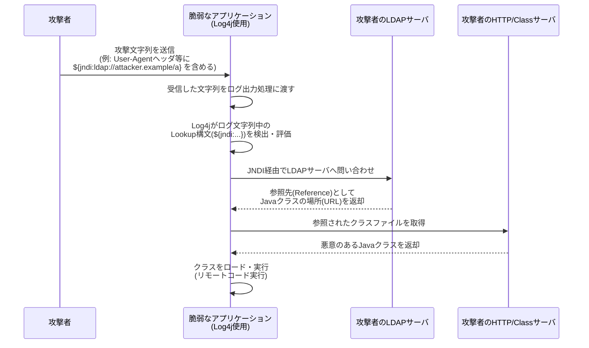

# 攻撃手順と対策

## Log4Shell

### 概要

- `Log4Shell`（CVE-2021-44228）は Apache Log4j 2 に存在した脆弱性
- ログ出力対象の文字列に含まれる `${jndi:...}` 形式の**Lookup構文**が、ログ出力時に評価・実行されてしまうことが原因
- 攻撃者が制御可能な文字列（HTTPヘッダ、フォーム入力など）がログ出力される箇所であれば、任意の外部サーバへ接続させることが可能
- `JNDI`（Java Naming and Directory Interface）経由で `LDAP` や `RMI` などのプロトコルを使い、外部から任意の Java クラスをロード・実行させることでリモートコード実行（RCE）に繋がる

### 攻撃手順

### 攻撃と対策

| 攻撃要件 | 成功条件 | 対策 |
| --- | --- | --- |
| Javaのバージョン | <ul><li>JNDIのリモートクラスロードがデフォルトで無効化される前のバージョン</li><li>`com.sun.jndi.ldap.object.trustURLCodebase` が `true` の環境</li></ul> | <ul><li>JDK/JREを最新バージョンへアップデート</li><li>`trustURLCodebase` を `false` に明示的に設定</li></ul> |
| ログ出力処理 | ログ出力処理する文字列中に攻撃文字列（`${jndi:ldap://...}`等）を含める | <ul><li>Log4jを脆弱性修正済みバージョン（2.17.1以降等）へアップデート</li><li>環境変数 `LOG4J_FORMAT_MSG_NO_LOOKUPS=true` を設定</li><li>JVM引数 `-Dlog4j2.formatMsgNoLookups=true` を設定（バージョンによる）</li></ul> |
| Log4jのライブラリ構成 | 脆弱なバージョンの `log4j-core` がクラスパス上に存在する | <ul><li>`JndiLookup` クラスをjarから削除（暫定対応）</li><li>利用中の全依存ライブラリ（SBOM）を棚卸しし、間接依存も含め脆弱バージョンを排除</li></ul> |
| ネットワーク到達性 | アプリケーションサーバから外部（攻撃者LDAP/HTTPサーバ）への通信が許可されている | <ul><li>WAFで `${jndi:` 等のパターンを検知・遮断</li><li>アプリケーションサーバからの不要な外向き通信（アウトバウンド）をファイアウォールで制限</li></ul> |
| 入力文字列の経路 | ユーザ制御可能な入力（HTTPヘッダ、User-Agent、フォーム値等）がログに出力される | <ul><li>ログ出力前に入力値のサニタイズ・エスケープを実施</li><li>外部入力を直接ログメッセージに含めない設計にする</li></ul> |
