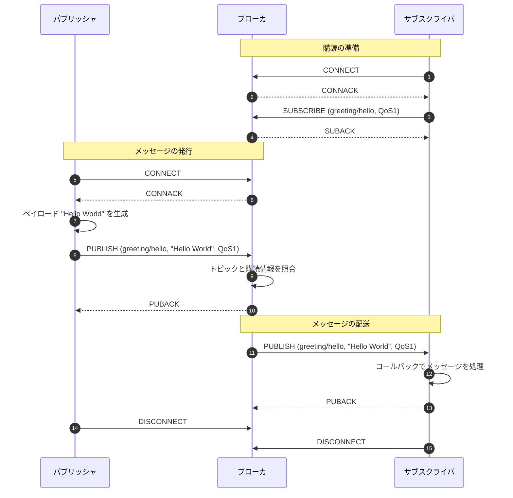
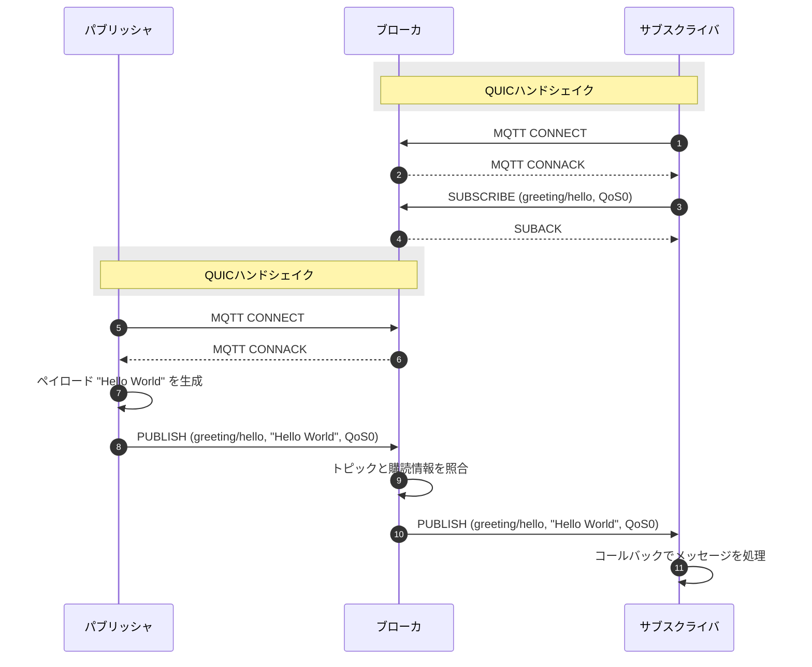
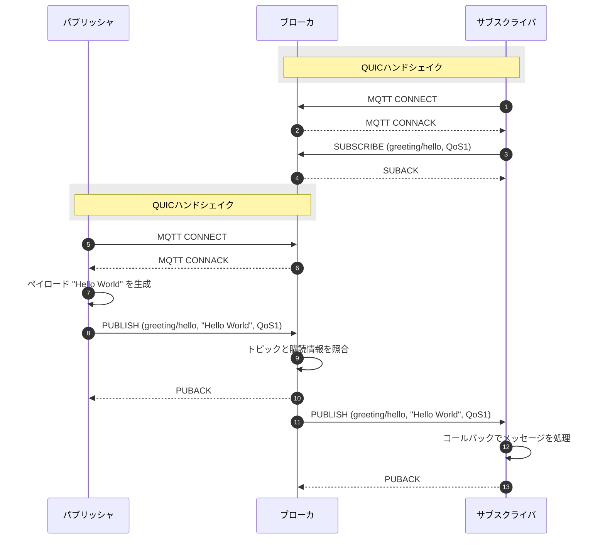
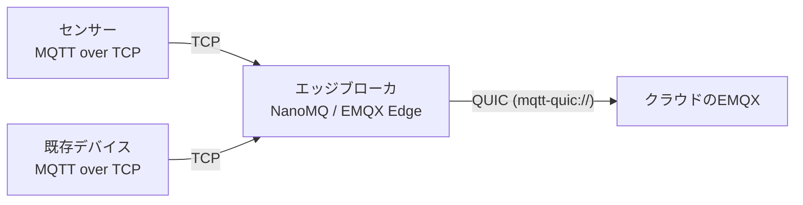

# MQTT

## 概要

MQTT（Message Queuing Telemetry Transport）は、**Publish/Subscribe（出版/購読）型**の軽量なメッセージングプロトコルである。メッセージの送受信は、**ブローカ（Broker／サーバ）を介して**行われる。メッセージを送信するクライアント（パブリッシャ）と受信するクライアント（サブスクライバ）は直接通信せず、いずれもブローカに接続する。ブローカは、パブリッシャから受け取ったメッセージを、そのトピックを購読しているサブスクライバへ配送する役割を担う。

もともとは帯域が狭く不安定な回線上のセンサー機器との通信を想定して設計され、現在はIoT分野のデファクトスタンダードとして広く使われている。OASISおよびISO/IEC 20922として標準化されており、主に使われるバージョンは3.1.1と5.0である。

### 特徴

| 項目 | 内容 |
|------|------|
| 通信モデル | Pub/Sub型（送信側と受信側が直接通信しない） |
| トランスポート | TCP/IP上で動作（TLS・WebSocketも利用可）。QUIC上で動作させる拡張（MQTT over QUIC）もある |
| ヘッダサイズ | 固定ヘッダは最小2バイトと非常に小さい |
| 既定ポート | 1883（平文）、8883（TLS） |
| 品質保証 | QoS 0/1/2の3段階から選択可能 |
| 接続形態 | 常時接続（Keep Aliveで死活監視） |
| 主な用途 | IoTセンサー、スマートホーム、車載、モバイルプッシュ通知 |

### HTTPとの比較

| 比較項目 | MQTT | HTTP |
|----------|------|------|
| 通信モデル | Pub/Sub（1対多が得意） | リクエスト/レスポンス（1対1） |
| 通信の起点 | 双方向（ブローカ経由で push 可能） | クライアント起点のみ |
| オーバーヘッド | 小さい | 大きい |
| 接続 | 常時接続 | 都度接続（Keep-Aliveあり） |
| 配信保証 | QoSで選択可能 | プロトコルとしては規定なし |
| 向いている用途 | 低帯域・不安定回線・多数デバイス | Webアプリ・REST API |

## 仕組み

MQTTは、メッセージを仲介する**ブローカ（Broker）**を中心とした構成をとる。

| 役割 | 説明 |
|------|------|
| パブリッシャ（Publisher） | トピックを指定してメッセージを送信するクライアント |
| ブローカ（Broker） | メッセージを受け取り、該当トピックを購読しているクライアントへ配送するサーバ |
| サブスクライバ（Subscriber） | 関心のあるトピックを購読し、メッセージを受信するクライアント |

パブリッシャとサブスクライバは互いの存在を知らず、**トピック**（例: `home/livingroom/temperature`）のみで結び付く。そのため、送信側・受信側を独立して増減できる。

### トピックとワイルドカード

トピックは `/` 区切りの階層構造を持ち、購読時のみワイルドカードを使用できる。

| ワイルドカード | 意味 | 購読例 | マッチするトピック例 |
|----------------|------|--------|----------------------|
| `+` | 1階層の任意の文字列 | `home/+/temperature` | `home/livingroom/temperature` |
| `#` | 0階層以上の任意の文字列（末尾のみ） | `home/#` | `home/livingroom/temperature`、`home/kitchen/light/state` |

### QoS（Quality of Service）

| QoS | 名称 | 配信保証 | 主なパケット | 用途の例 |
|-----|------|----------|--------------|----------|
| 0 | At most once | 最大1回（欠落・再送なし） | PUBLISH | 頻繁に更新されるセンサー値 |
| 1 | At least once | 最低1回（重複の可能性あり） | PUBLISH, PUBACK | 一般的な通知・制御 |
| 2 | Exactly once | ちょうど1回 | PUBLISH, PUBREC, PUBREL, PUBCOMP | 課金・重複が許されない処理 |

### 主な制御パケット

| パケット | 方向 | 説明 |
|----------|------|------|
| CONNECT | Client → Broker | 接続要求（ClientId、認証情報、Keep Aliveなどを含む） |
| CONNACK | Broker → Client | 接続要求に対する応答 |
| PUBLISH | 双方向 | メッセージの送信 |
| PUBACK | 双方向 | QoS 1のPUBLISHに対する応答 |
| SUBSCRIBE | Client → Broker | トピックの購読要求 |
| SUBACK | Broker → Client | 購読要求に対する応答 |
| UNSUBSCRIBE | Client → Broker | 購読の解除要求 |
| PINGREQ / PINGRESP | Client ⇄ Broker | Keep Alive用の死活監視 |
| DISCONNECT | Client → Broker | 正常切断の通知 |

### 付随機能

| 機能 | 説明 |
|------|------|
| Retain | ブローカがトピックごとに最新メッセージ1件を保持し、新規購読者へ即座に配信する |
| Last Will | クライアントが異常切断した際、ブローカが代わりに指定メッセージを発行する |
| Clean Session（3.1.1）/ Clean Start（5.0） | 切断後に購読情報や未配信メッセージを保持するかどうかを指定する |
| Keep Alive | 一定時間通信がない場合にPINGで接続の生存を確認する |

### 処理フロー

QoS 1で、パブリッシャが `Hello World` というメッセージをトピック `greeting/hello` に送信し、サブスクライバが受信する流れを示す。



### ステップ詳細

内部処理は、**処理を行っている主体を送信者**とし、受信者欄には `送信なし<br>(内部の処理)` と記載する。

| ステップ | 送信者 | 受信者 | 送信物 | 格納場所 | 受信後の処理 |
|----------|--------|--------|--------|----------|--------------|
| 1 | サブスクライバ | ブローカ | CONNECT（ClientId、Keep Alive、Clean Session） | ブローカのセッション管理領域 | 認証・ClientIdの重複確認を行い、セッションを作成する |
| 2 | ブローカ | サブスクライバ | CONNACK（Return Code、Session Present） | サブスクライバの接続状態（メモリ） | 接続成功を確認し、接続済み状態へ遷移する |
| 3 | サブスクライバ | ブローカ | SUBSCRIBE（トピックフィルタ `greeting/hello`、QoS1、Packet ID） | ブローカのサブスクリプションテーブル | 権限を確認し、購読情報を登録する |
| 4 | ブローカ | サブスクライバ | SUBACK（Packet ID、付与されたQoS） | サブスクライバの購読状態（メモリ） | 購読成功を確認する |
| 5 | パブリッシャ | ブローカ | CONNECT（ClientId、Keep Alive、Clean Session） | ブローカのセッション管理領域 | 認証・ClientIdの重複確認を行い、セッションを作成する |
| 6 | ブローカ | パブリッシャ | CONNACK（Return Code、Session Present） | パブリッシャの接続状態（メモリ） | 接続成功を確認し、接続済み状態へ遷移する |
| 7 | パブリッシャ | 送信なし<br>(内部の処理) | なし | パブリッシャのメモリ（送信バッファ） | 文字列 `Hello World` をバイト列のペイロードとして準備する |
| 8 | パブリッシャ | ブローカ | PUBLISH（トピック `greeting/hello`、ペイロード `Hello World`、QoS1、Packet ID） | パブリッシャの未確認メッセージ領域（PUBACK受信まで保持） | ブローカがメッセージを受理する |
| 9 | ブローカ | 送信なし<br>(内部の処理) | なし | ブローカのメモリ（必要に応じてRetainストア・セッションキュー） | トピックと購読情報を照合し、配送先を決定する |
| 10 | ブローカ | パブリッシャ | PUBACK（Packet ID） | パブリッシャの未確認メッセージ領域 | 対応するPacket IDのメッセージを破棄し、送信完了とする |
| 11 | ブローカ | サブスクライバ | PUBLISH（トピック `greeting/hello`、ペイロード `Hello World`、QoS1、Packet ID） | ブローカの配送待ちキュー（PUBACK受信まで保持） | サブスクライバがメッセージを受信する |
| 12 | サブスクライバ | 送信なし<br>(内部の処理) | なし | サブスクライバのメモリ（受信バッファ） | 受信コールバックを呼び出し、`Hello World` をアプリケーションで処理する |
| 13 | サブスクライバ | ブローカ | PUBACK（Packet ID） | ブローカの配送待ちキュー | 該当メッセージをキューから破棄し、配送完了とする |
| 14 | パブリッシャ / サブスクライバ | ブローカ | DISCONNECT | ブローカのセッション管理領域 | Clean Sessionの場合はセッション情報を破棄し、TCP接続を閉じる |

## 実装例（Python / paho-mqtt）

ソースコード内のコメントは Markdown 記法で記述する。

### パブリッシャ

```python
import paho.mqtt.client as mqtt

# ## パブリッシャ
# `greeting/hello` に `Hello World` を QoS1 で送信する。

client = mqtt.Client(mqtt.CallbackAPIVersion.VERSION2, client_id="publisher-01")
client.connect("localhost", 1883, keepalive=60)
client.loop_start()

# ### publish の引数
#
# | 引数 | 型 | 説明 |
# |------|-----|------|
# | `topic` | str | 送信先トピック |
# | `payload` | str / bytes | メッセージ本体 |
# | `qos` | int | 品質レベル（0 / 1 / 2） |
# | `retain` | bool | Retain フラグ |
info = client.publish("greeting/hello", "Hello World", qos=1)
info.wait_for_publish()  # PUBACK を受信するまで待機

client.loop_stop()
client.disconnect()
```

### サブスクライバ

```python
import paho.mqtt.client as mqtt

# ## コールバック
#
# | 引数 | 型 | 説明 |
# |------|-----|------|
# | `client` | Client | クライアントインスタンス |
# | `userdata` | any | ユーザ定義データ |
# | `msg` | MQTTMessage | 受信メッセージ（`topic` / `payload` / `qos` / `retain`） |
def on_message(client, userdata, msg):
    print(f"{msg.topic}: {msg.payload.decode()}")  # `Hello World` を出力

client = mqtt.Client(mqtt.CallbackAPIVersion.VERSION2, client_id="subscriber-01")
client.on_message = on_message
client.connect("localhost", 1883, keepalive=60)
client.subscribe("greeting/hello", qos=1)
client.loop_forever()
```

## MQTT over QUIC

### 背景と課題

MQTTは標準仕様上、**TCPのような信頼性のある順序保証付きのバイトストリーム**の上で動作することを前提としている。しかし、モバイル回線・車載・広域IoTなど、回線品質が不安定で、IPアドレスの変化（Wi-Fiとセルラーの切り替えなど）が頻繁に起きる環境では、TCPベースのMQTTに次のような課題がある。

| 課題 | TCP（+TLS）上のMQTTでの問題 |
|------|------------------------------|
| 接続確立の遅さ | TCPの3-wayハンドシェイクの後にTLSハンドシェイク、さらにMQTTのCONNECT/CONNACKが必要で、往復回数（RTT）が多い |
| Head-of-Line Blocking | 1つのTCP接続上のパケットロスが、同じ接続上の他のトピックのメッセージ配送もブロックする |
| 回線切り替えへの弱さ | 接続が送信元IP/ポートに紐づくため、アドレスが変わると切断され、再接続が必要になる |
| 再接続のコスト | 切断のたびにハンドシェイクをやり直す必要がある |

### QUICとは

QUIC（Quick UDP Internet Connections）は、**UDP上に実装されたトランスポートプロトコル**であり、HTTP/3の基盤としても使われている（RFC 9000）。TCPの信頼性・輻輳制御とTLS 1.3の暗号化を統合しつつ、ストリーム多重化などを提供する。

| 比較項目 | TCP + TLS | QUIC |
|----------|-----------|------|
| 下位プロトコル | IP | UDP（上にQUICを実装） |
| 暗号化 | TLSを別層として追加（任意） | TLS 1.3を内包（常に暗号化） |
| ハンドシェイク | TCPとTLSで別々に実施 | トランスポートとTLSを統合して実施 |
| 多重化 | 1接続1ストリーム | 1接続で複数の独立したストリーム |
| Head-of-Line Blocking | 発生する | ストリーム間では発生しない |
| 接続の識別 | 送信元/宛先のIP・ポートの組 | Connection IDで識別（アドレス変更に強い） |
| 再接続の高速化 | TLSセッション再開など | 0-RTTで初回パケットからデータ送信可能 |
| 実装場所 | OSカーネル | 主にユーザ空間（ライブラリ） |

### MQTT over QUICの概要

MQTT over QUICは、MQTTのトランスポート層をTCPからQUICに置き換える方式である。MQTTのパケット形式やPub/Subの仕組み自体は変わらず、これらをQUICのストリーム上で運ぶ。

EMQXでは、クライアントがQUIC接続を開始して**双方向ストリーム**を作成し、そのストリーム上でEMQXとクライアントがMQTTパケットをやり取りする。QUICのハンドシェイクに失敗した場合は、クライアントが**TCPへ自動的にフォールバック**する設計になっている。

#### 接続確立の往復回数（理論値）

| 方式 | CONNECTを送れるまで | CONNACK受信まで（合計） | 備考 |
|------|----------------------|--------------------------|------|
| MQTT over TCP | 1 RTT（TCP） | 2 RTT | 平文の場合 |
| MQTT over TLS/TCP（TLS 1.3） | 2 RTT（TCP + TLS） | 3 RTT | TCPとTLSのハンドシェイクが直列 |
| MQTT over QUIC（初回） | 1 RTT（QUIC + TLS統合） | 2 RTT | 暗号化込み |
| MQTT over QUIC（0-RTT再接続） | 0 RTT | 1 RTT | 初回パケットにCONNECTを載せられる |

> 上記は理論上の往復回数であり、実際の遅延は回線やサーバ実装、設定に依存する。

#### Hello Worldの送受信シーケンス

QUICハンドシェイクは1つの箱に抽象化し（詳細は別項目で扱う）、その後の `Hello World` がサブスクライバに届くまでの流れを示す。ここではシングルストリームモードを想定し、MQTTパケットはすべてQUICの1本の双方向ストリーム上で送受信されるものとする。

##### QoS 0



##### QoS 1



| 比較項目 | QoS 0 | QoS 1 |
|----------|-------|-------|
| パブリッシャ → ブローカのPUBACK | なし | あり |
| ブローカ → サブスクライバのPUBACK | なし | あり |
| 再送 | なし | PUBACKが返らなければ再送（重複の可能性あり） |
| パケット数（PUBLISH関連） | 2 | 4 |


### 動作モード（EMQXの場合）

EMQXではクライアントとの間に2つの動作モードがある。

| 項目 | シングルストリームモード | マルチストリームモード |
|------|--------------------------|------------------------|
| 概要 | 1本の双方向QUICストリームにMQTTパケットをすべて載せる | 複数のQUICストリームでMQTTパケットを運ぶ |
| ストリーム構成 | データ用ストリーム1本のみ | 制御ストリーム1本 + 複数のデータストリーム |
| 制御パケット（CONNECT / CONNACK / PINGなど） | 同一ストリーム | 制御ストリームで処理 |
| Pub/Subデータ | 同一ストリーム | データストリームで処理（制御ストリームでも可） |
| 順序保証 | 接続全体で保証 | **ストリームごと**に保証 |
| Head-of-Line Blocking | トピック間で発生しうる | トピック（ストリーム）間では発生しない |
| 優先度・フロー制御 | 接続単位 | ストリーム単位で設定可能 |
| 主なメリット | 高速ハンドシェイク、0-RTT、アドレス移行、損失検知と回復 | 上記に加え、並列処理、優先度付け、部分的な障害隔離、購読遅延の低減 |
| 実装の難易度 | 低い（TCP版に近い） | 高い（ストリーム設計が必要） |

#### マルチストリームでのストリームの割り当て例

クライアント側でストリームの割り当てを自由に決められる。

| 割り当て方針 | 例 |
|--------------|----|
| トピックごと | トピックAとトピックBを別ストリームにし、互いの遅延・ロスの影響を排除する |
| QoSごと | QoS 1用とQoS 0用でストリームを分ける |
| 方向ごと | 送信（Publish）用と購読（Subscribe）用でストリームを分ける |

ブローカ側（EMQX）は、ストリームとパケットを次のように紐づけて処理する。

| 受信したパケット | 応答の送信先ストリーム |
|------------------|------------------------|
| QoS 1のPUBLISH | 受信したストリームと同じストリームでPUBACKを返す（QoS 2も同様） |
| SUBSCRIBE（購読を受け付けたストリーム） | そのストリームでPUBLISHを配送し、QoS 1のPUBACKも同じストリームで受け取る |

> 順序が重要で相関のある複数のトピックは、**同一のストリームに割り当てる**必要がある（順序はストリーム単位でのみ保証されるため）。

### MQTT over QUICの利点

| 利点 | 内容 |
|------|------|
| 接続確立の高速化 | トランスポートとTLSのハンドシェイクが統合されており、MQTTの接続を早く確立できる |
| Head-of-Line Blockingの回避 | ストリームが独立しているため、1つのストリームでのロスが他に波及しない |
| 不安定回線での耐性 | パケットロスやネットワークの揺らぎに強く、再接続が速い |
| 組み込みのセキュリティ | TLS 1.3相当の暗号化・認証が常に有効 |
| コネクションマイグレーション | IPアドレスやポートが変わっても接続を維持できる（NATリバインディングや移動体向け） |
| 輻輳制御の柔軟性 | ユーザ空間実装のため、輻輳制御アルゴリズムの調整・差し替えがしやすい |

### 注意点・課題

| 項目 | 内容 |
|------|------|
| 標準化 | MQTT over QUICはMQTTの標準仕様には含まれていない。EMQXのドキュメントでは、本番導入が可能な水準にあるとしつつ、EMQがOASISでの標準化を推進中と説明されている |
| UDPの利用 | UDPが制限・遮断されるネットワークでは使えない（その場合はTCPへフォールバックする設計が重要） |
| 既定ポート | EMQXのQUICリスナーはUDPの14567番を使用する（TCPの1883/8883とは別） |
| クライアントSDK | 対応SDKは少なく、通常のMQTTクライアントと比べて機能が揃っていない場合がある |
| ロードバランサ | UDPやConnection IDを考慮する必要がある。EMQXのKubernetes構成例ではLoadBalancerよりNodePortでの公開が選ばれている |
| 実装負荷 | ユーザ空間でのQUIC処理のため、CPU使用率やメモリ使用量の評価が必要 |
| 実装の成熟度 | 初期は実験的機能として提供されていた。採用時は使用するバージョンと対応状況の確認が必要 |

### EMQXでの利用

EMQX 5.0でQUICリスナーが導入された。既定では無効のため、設定で有効化する。

#### Dockerでの起動例

```bash
# ## EMQXのQUICリスナーを有効化して起動
# ポート `14567` でQUIC（UDP）を待ち受ける。
docker run -d --name emqx \
  -e EMQX_LISTENERS__QUIC__DEFAULT__ENABLED=true \
  -p 14567:14567/udp \
  emqx/emqx:5.8.8
```

#### 設定ファイル（HOCON）での有効化例

```hocon
# ## listeners.quic.default
# QUICリスナーの設定。QUICはTLS 1.3を内包するため、証明書と秘密鍵が必要になる。
#
# | 項目 | 説明 |
# |------|------|
# | `enabled` | リスナーを有効にするか |
# | `bind` | 待ち受けアドレスとポート（UDP） |
# | `max_connections` | 最大接続数 |
# | `keyfile` | 秘密鍵のパス |
# | `certfile` | サーバ証明書のパス |
listeners.quic.default {
  enabled = true
  bind = "0.0.0.0:14567"
  max_connections = 1024000
  keyfile = "etc/certs/key.pem"
  certfile = "etc/certs/cert.pem"
}
```

有効化後は、`emqx ctl listeners` でQUICリスナーが `running : true` になっていることを確認できる。

### クライアント・周辺ツール

| 名称 | 種別 | 説明 |
|------|------|------|
| NanoSDK | クライアントSDK | MsQuicベースのC言語向けMQTT over QUIC SDK。EMQX 5.0と互換。Java・Pythonのバインディングもある |
| NanoMQ | ブローカ / ブリッジ | 軽量ブローカ。TCP接続のデバイスのデータをQUICでEMQXへブリッジできる（`mqtt-quic://` スキーム） |
| nanomq_cli | CLIツール | `quic conn` / `quic sub` などでQUIC接続や購読を試験できる |
| emqtt-bench | ベンチマーク | MQTTの性能試験ツール。QUICに対応しており、TCP/TLSとの比較計測に使える |
| EMQX Edge | エッジブローカ | エッジ〜クラウド間のブリッジにQUICを使用できる（配下のデバイスはTCPのままでよい） |

#### ブリッジ構成（既存デバイスを変更せずQUICを利用する）

SDKを更新できない既存デバイスがある場合は、デバイスとエッジ間はTCPのまま、エッジとクラウド間のみQUICにする構成が取れる。



#### NanoMQのブリッジ設定例

```conf
# ## ブリッジ接続先
# | 項目 | 説明 |
# |------|------|
# | `bridge.mqtt.emqx.address` | 接続先の `scheme://host:port`。QUICの場合は `mqtt-quic://` |
bridge.mqtt.emqx.address=mqtt-quic://127.0.0.1:14567
```

### 研究の観点（検討事項）

| 観点 | 内容 |
|------|------|
| 性能比較 | TCP / TLS-TCP / QUICでの接続確立時間、スループット、遅延を比較する（パケットロス率や遅延を変えた回線条件で評価） |
| モビリティ | コネクションマイグレーションが、IPアドレス変更時の切断回数・復旧時間に与える効果を評価する |
| マルチストリーム | トピックごとのストリーム割り当てが、Head-of-Line Blockingの回避や優先度制御に与える効果を評価する |
| 0-RTT | 再接続の高速化の効果と、0-RTTデータのリプレイ攻撃への対処（冪等性の確保）を検討する |
| リソース消費 | 組み込み機器でのCPU・メモリ・消費電力、ユーザ空間でのQUIC実装の負荷を評価する |
| 運用面 | UDPが制限される環境でのフォールバック、ロードバランサ・ファイアウォールとの相性を整理する |
| 標準化 | OASISでの標準化動向と、MQTT 5.0との整合性を調査する |

## 代表的なブローカ実装

| 名称 | 種別 | 特徴 |
|------|------|------|
| Eclipse Mosquitto | OSS | 軽量。小規模〜中規模向け |
| EMQX | OSS / 商用 | 大規模クラスタ対応。MQTT 5.0対応。5.0以降でMQTT over QUICのリスナーを提供 |
| NanoMQ | OSS | 軽量なエッジ向けブローカ。NanoSDKによるMQTT over QUICのクライアント実装やQUICブリッジを提供 |
| HiveMQ | 商用 / Community | エンタープライズ向け機能が豊富 |
| AWS IoT Core | マネージド | AWSサービスとの連携が容易 |
| Azure IoT Hub | マネージド | Azureサービスとの連携が容易 |

## まとめ

- MQTTはブローカを介した軽量なPub/Sub型プロトコルで、パブリッシャとサブスクライバが疎結合になる。
- トピックの階層構造とワイルドカードにより、柔軟な購読が行える。
- QoS・Retain・Last Willにより、回線品質や用途に応じた信頼性の制御ができる。
- 低帯域・不安定回線・多数デバイスの環境（IoT）に特に適している。
- MQTT over QUICは、トランスポートをTCPからQUICに置き換え、接続の高速化・Head-of-Line Blockingの回避・コネクションマイグレーションを実現する。EMQX 5.0以降で利用でき、標準化はOASISで進められている。

## 参考資料

| 資料 | URL |
|------|-----|
| EMQX Docs: MQTT over QUIC | https://docs.emqx.com/en/emqx/latest/mqtt-over-quic/introduction.html |
| EMQX Docs: Features and Benefits | https://docs.emqx.com/en/emqx/latest/mqtt-over-quic/features-mqtt-over-quic.html |
| EMQX Docs: Use MQTT over QUIC | https://docs.emqx.com/en/emqx/latest/mqtt-over-quic/getting-started.html |
| EMQX Edge: MQTT over QUIC Bridge | https://docs.emqx.com/en/emqx-edge/latest/bridges/quic-bridge.html |
| MQTT 5.0 仕様（OASIS） | https://docs.oasis-open.org/mqtt/mqtt/v5.0/mqtt-v5.0.html |
