# UML図一覧

UML 2.x で定義されている14種類の図を、構造図7種・振る舞い図7種に分けて整理する。
描き方の例は Mermaid.js の記法で記載している。

## 図の分類と Mermaid.js 対応状況

| 分類 | 図の名前 | Mermaid.js の対応 | 使用する記法 |
|------|----------|-------------------|--------------|
| 構造図 | クラス図 | ネイティブ対応 | `classDiagram` |
| 構造図 | オブジェクト図 | 代用 | `classDiagram` |
| 構造図 | コンポーネント図 | 代用 | `flowchart` |
| 構造図 | 複合構造図 | 代用 | `flowchart` |
| 構造図 | 配置図 | 代用 | `flowchart` |
| 構造図 | パッケージ図 | 代用 | `flowchart` |
| 構造図 | プロファイル図 | 代用 | `classDiagram` |
| 振る舞い図 | ユースケース図 | 代用 | `flowchart` |
| 振る舞い図 | アクティビティ図 | 代用 | `flowchart` |
| 振る舞い図 | ステートマシン図 | ネイティブ対応 | `stateDiagram-v2` |
| 振る舞い図 | シーケンス図 | ネイティブ対応 | `sequenceDiagram` |
| 振る舞い図 | コミュニケーション図 | 代用 | `flowchart` |
| 振る舞い図 | タイミング図 | 代用(近似) | `gantt` |
| 振る舞い図 | 相互作用概要図 | 代用 | `flowchart` |

---

# 構造図

## クラス図

### 描き方

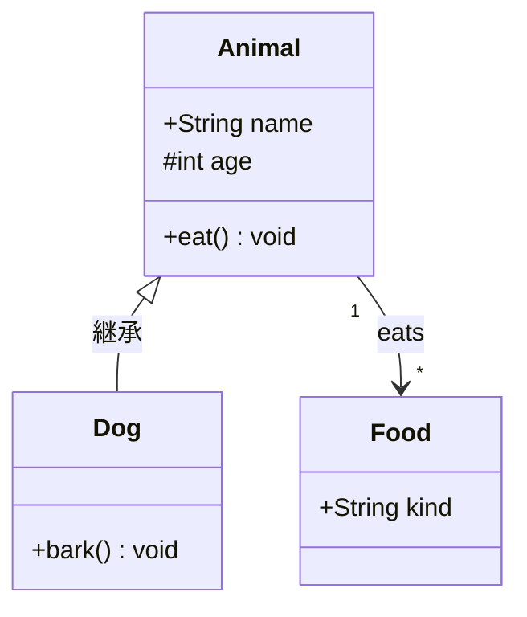

### 特徴

- クラスの属性・操作・関係(継承、関連、集約、コンポジション、依存)を表す
- 多重度や可視性(`+` `-` `#` `~`)を記述できる
- UMLの中で最も利用頻度が高く、静的構造を表現する基本の図

### 用途

- オブジェクト指向設計・詳細設計
- ドメインモデルの整理
- データベース設計(ER図の代わり)の下書き

## オブジェクト図

### 描き方

Mermaid.js に専用の記法がないため、`classDiagram` でインスタンスを表現する。

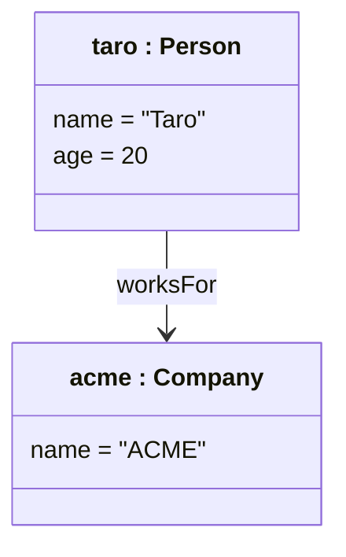

### 特徴

- ある時点でのインスタンス(オブジェクト)とその関係のスナップショットを表す
- 名前は `オブジェクト名 : クラス名` の形式で書き、属性には具体的な値を入れる
- クラス図の具体例として機能する

### 用途

- クラス図の妥当性確認(具体値での検証)
- 複雑な関連構造の説明
- テストデータの構造の可視化

## コンポーネント図

### 描き方

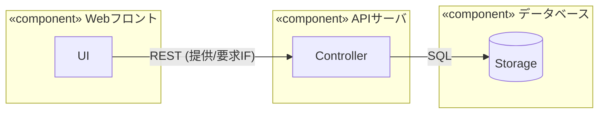

### 特徴

- システムを交換可能な部品(コンポーネント)とそのインタフェースで表す
- 提供インタフェース(ロリポップ)と要求インタフェース(ソケット)で依存関係を示す
- 実装の詳細を隠蔽し、モジュール間の境界を明確にする

### 用途

- アーキテクチャ設計
- モジュール分割・サービス分割の検討
- 外部システム連携の整理

## 複合構造図

### 描き方

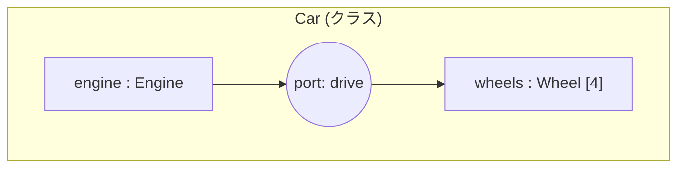

### 特徴

- クラスやコンポーネントの内部構造(パーツ・ポート・コネクタ)を表す
- 内部のパーツ同士の連携を示せる
- クラス図では表現できない「内部の組み立て」を記述できる

### 用途

- 組込み・ハードウェア寄りの設計
- クラス内部の協調関係の説明
- 再利用可能なパターンの内部構造の記述

## 配置図

### 描き方

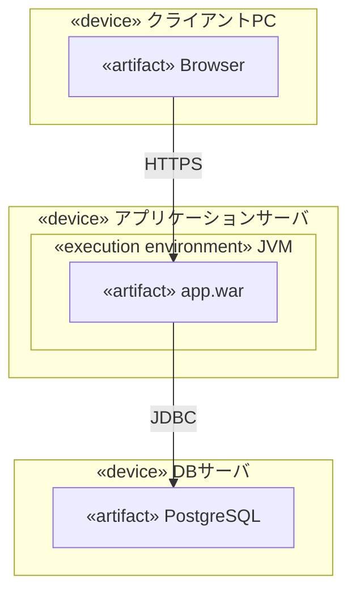

### 特徴

- ソフトウェア(成果物)がどのハードウェア(ノード)上で動作するかを表す
- ノード間の通信経路を示す
- 物理構成と論理構成の対応が分かる

### 用途

- インフラ構成の設計・説明
- 本番/ステージング環境の配置整理
- ネットワーク構成のレビュー

## パッケージ図

### 描き方

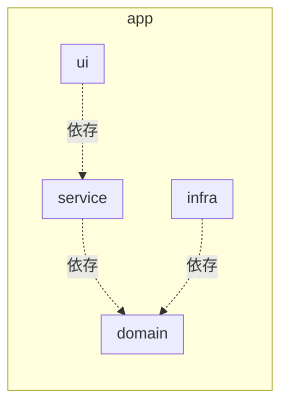

### 特徴

- クラスやコンポーネントをパッケージ(名前空間)でグループ化して表す
- パッケージ間の依存関係を示す
- 循環依存の発見に役立つ

### 用途

- レイヤードアーキテクチャの整理
- モジュール依存関係の可視化
- 大規模システムの全体俯瞰

## プロファイル図

### 描き方

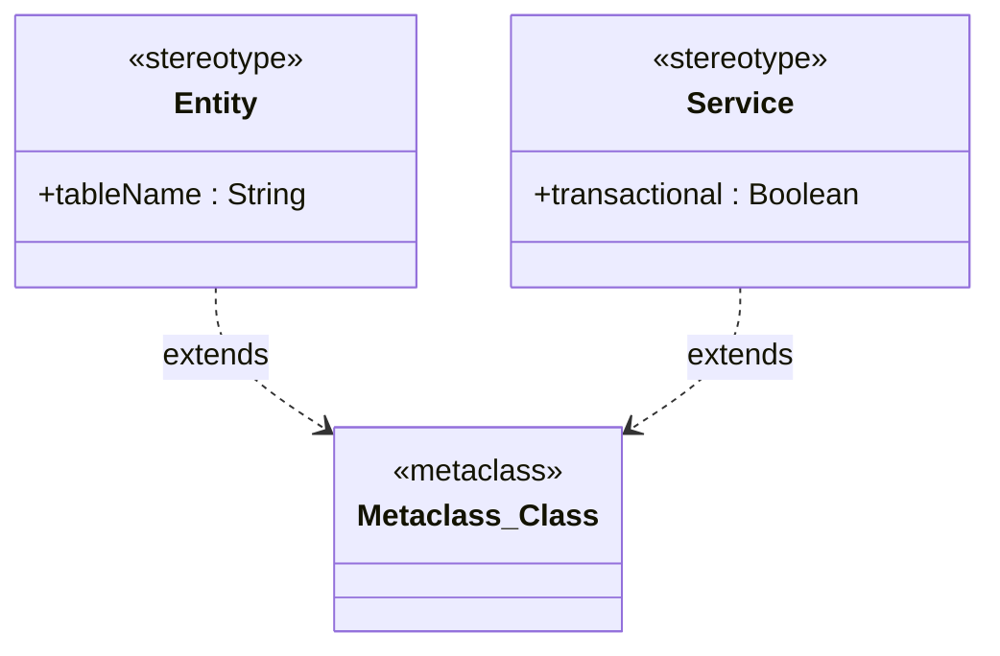

### 特徴

- ステレオタイプ・タグ付き値・制約を使って UML を特定領域向けに拡張する仕組みを定義する
- 既存のメタクラスを拡張する形で記述する
- UML自体のカスタマイズ(DSL化)に使う

### 用途

- ドメイン特化モデリング言語(SysML、MARTEなど)の定義
- 社内標準のモデリング規約の策定
- モデリングツールのカスタマイズ

---

# 振る舞い図

## ユースケース図

### 描き方

Mermaid.js に専用の記法がないため、`flowchart` で代用する。

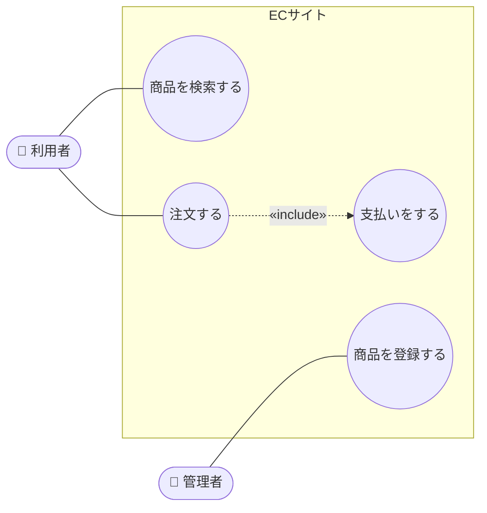

### 特徴

- システムの利用者(アクター)と、システムが提供する機能(ユースケース)の関係を表す
- システム境界で「何をシステムの範囲とするか」を示す
- `«include»` `«extend»` で機能の共通化・拡張を表現できる

### 用途

- 要件定義・機能一覧の整理
- 利用者視点での機能の洗い出し
- ステークホルダーとの合意形成

## アクティビティ図

### 描き方

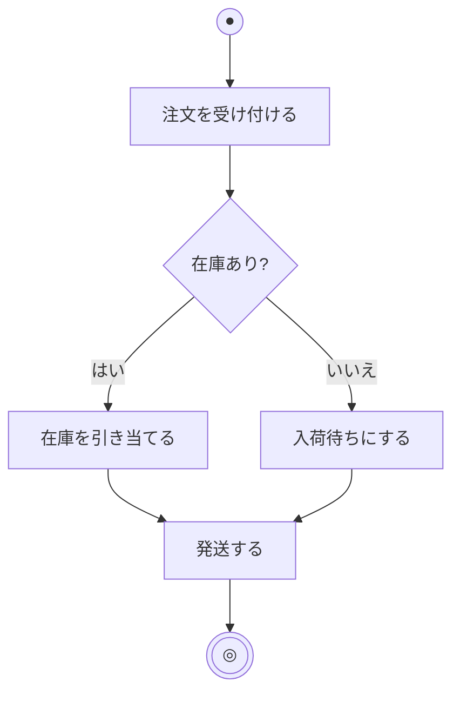

### 特徴

- 処理の流れ(アクション、分岐、並行処理、合流)を表す
- スイムレーンで責任の所在(誰が行うか)を分けて表現できる
- フローチャートに近く、並行処理を表せる点が強み

### 用途

- 業務フローの可視化
- アルゴリズム・処理フローの設計
- ユースケースの詳細な手順の記述

## ステートマシン図

### 描き方

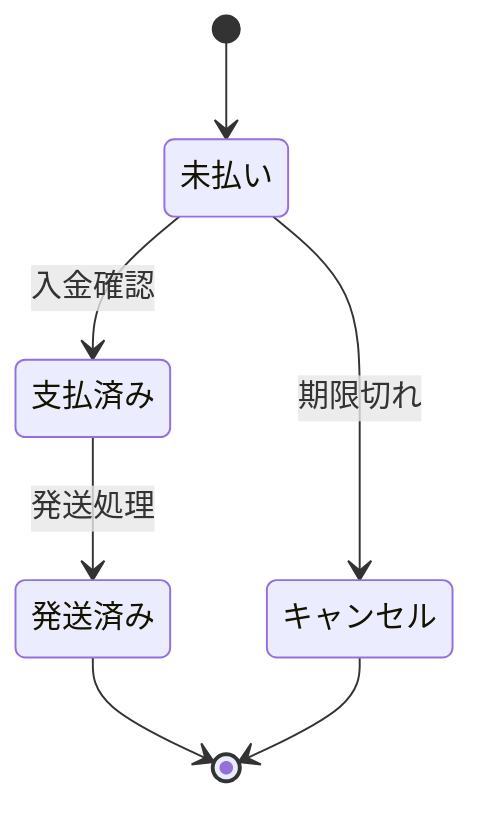

### 特徴

- オブジェクトの状態と、イベントによる状態遷移を表す
- ガード条件・アクション(entry / exit / do)を記述できる
- 複合状態や直交領域で複雑な状態も整理できる

### 用途

- 注文・申請などのライフサイクル設計
- UI画面遷移の設計
- 組込み機器・プロトコルの動作定義

## シーケンス図

### 描き方

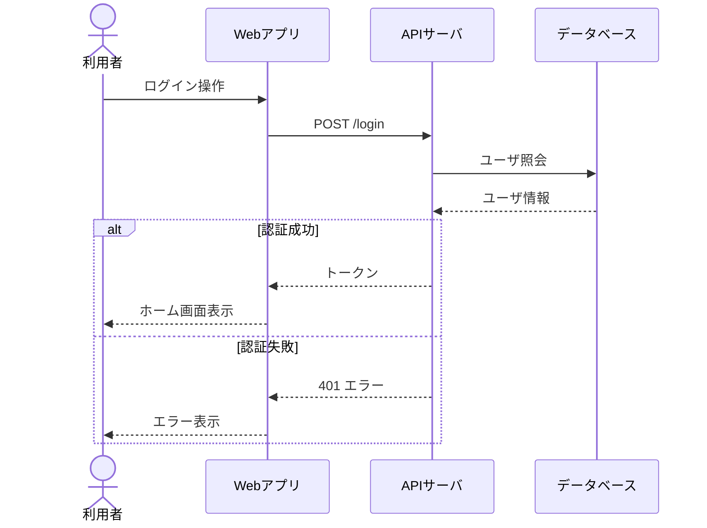

### 特徴

- オブジェクト間のメッセージのやり取りを時間順(上から下)に表す
- `alt` `loop` `opt` などの複合フラグメントで分岐・繰り返しを表現できる
- 同期/非同期メッセージ、戻りメッセージを区別して書ける

### 用途

- API・システム間連携の設計
- ユースケースの処理シナリオの詳細化
- 障害調査時の処理の流れの共有

## コミュニケーション図

### 描き方

Mermaid.js に専用の記法がないため、`flowchart` で代用する。メッセージの順序は番号で表す。

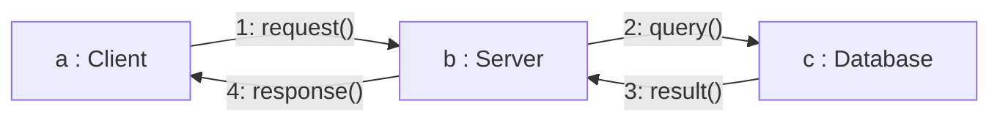

### 特徴

- オブジェクト間のつながり(リンク)を軸に、メッセージを番号付きで表す
- シーケンス図と意味的にほぼ等価だが、オブジェクトの配置関係を重視する
- 時間軸がないため、オブジェクト数が少ない場合に見やすい

### 用途

- オブジェクト間の協調関係の把握
- 小規模な相互作用の概要説明
- シーケンス図の代替表現

## タイミング図

### 描き方

Mermaid.js にUMLのタイミング図はないため、`gantt` で状態の時間変化を近似する。

```mermaid
gantt
    title ドアセンサーとライトの状態推移
    dateFormat  HH:mm:ss
    axisFormat  %S秒
    section ドア
    閉                :done, d1, 00:00:00, 3s
    開                :active, d2, after d1, 4s
    閉                :done, d3, after d2, 3s
    section ライト
    消灯              :done, l1, 00:00:00, 4s
    点灯              :active, l2, after l1, 4s
    消灯              :done, l3, after l2, 2s
```

### 特徴

- 横軸に時間、縦軸にライフライン(状態)を取り、状態の変化を時間に沿って表す
- 複数のオブジェクトの状態変化のタイミングを揃えて比較できる
- 時間制約(○ms以内など)を明示できる

### 用途

- 組込み・リアルタイムシステムの設計
- ハードウェア信号のタイミング設計
- 応答時間・タイムアウトの検討

## 相互作用概要図

### 描き方

Mermaid.js に専用の記法がないため、`flowchart` で代用する。

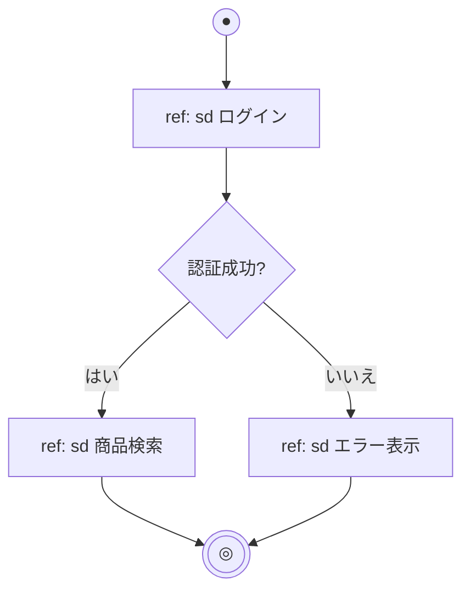

### 特徴

- アクティビティ図の形式で、複数のシーケンス図(相互作用)の実行順序を表す
- 各ノードがシーケンス図などへの参照(`ref`)になる
- 全体の流れと詳細な相互作用を階層的に整理できる

### 用途

- 複数のシナリオにまたがる処理の全体像の整理
- シーケンス図が大きくなった場合の分割・概観
- ユースケース全体の流れの把握
