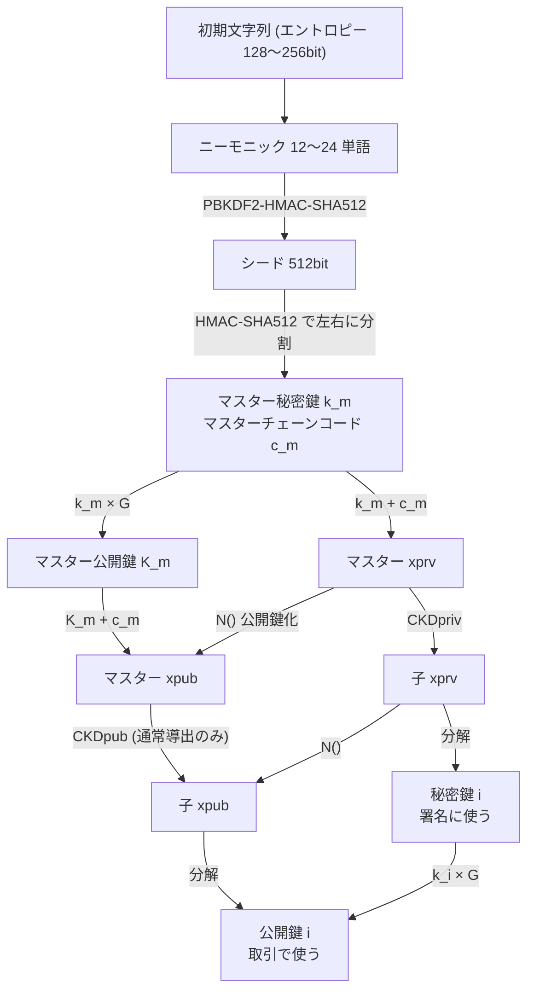
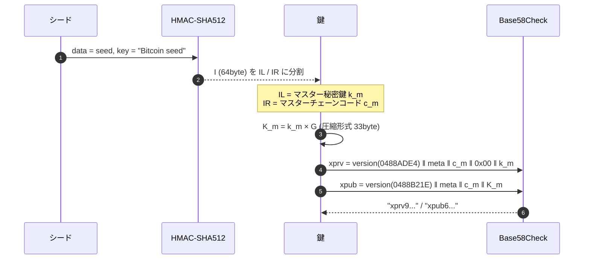
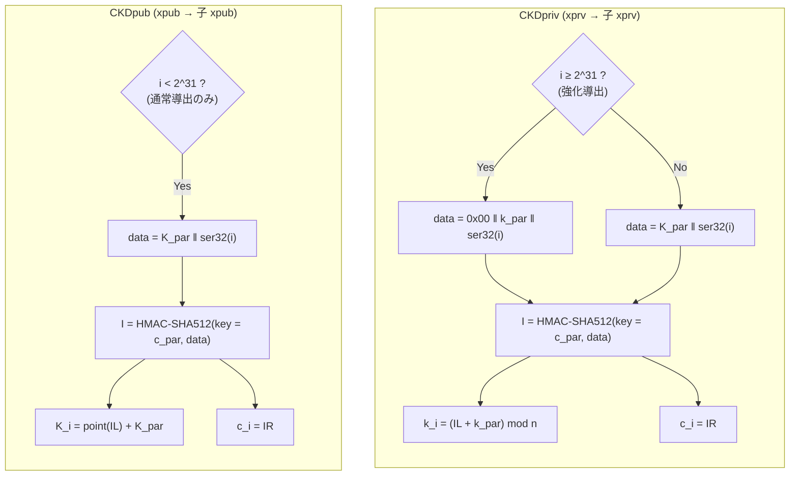
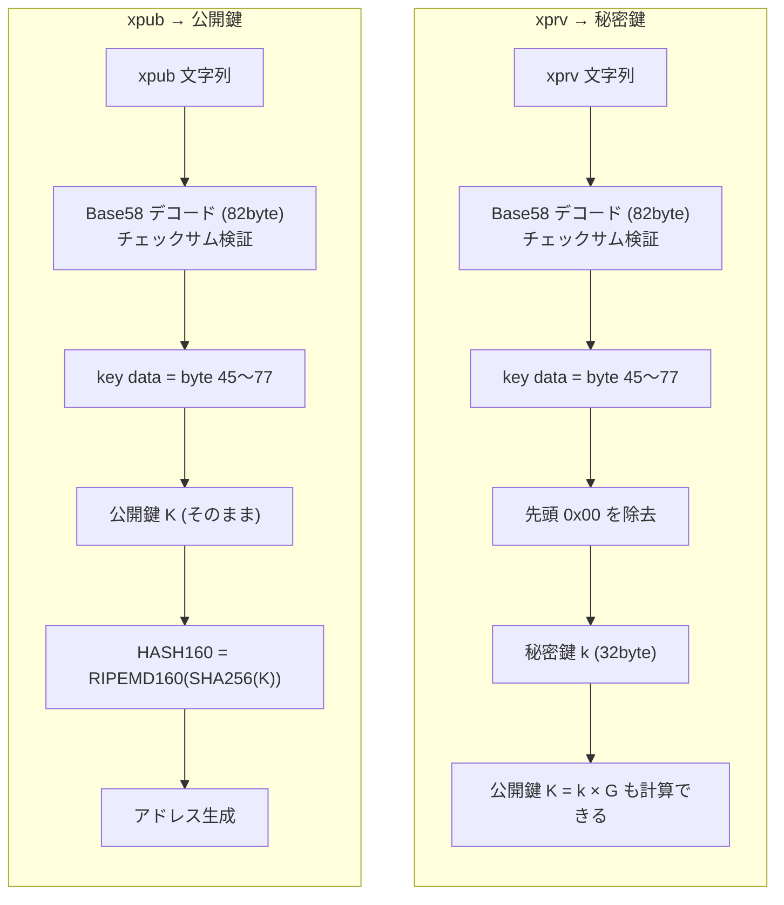

# 全体像

---

# 用語

| 用語 | 記号 | 中身 | 備考 |
|---|---|---|---|
| 初期文字列 (エントロピー) | | 乱数 128〜256bit | ニーモニックの元 |
| ニーモニック | | 12〜24 単語 | 一般的なバックアップ対象 |
| シード | | 512bit | ニーモニックから PBKDF2 で生成 |
| マスター秘密鍵 | `k_m` | 32byte | シードの HMAC-SHA512 左256bit |
| マスターチェーンコード | `c_m` | 32byte | シードの HMAC-SHA512 右256bit |
| マスター公開鍵 | `K_m` | 33byte | `k_m × G` |
| 拡張秘密鍵 (xprv) | | 秘密鍵 + チェーンコード + メタ情報 | 子鍵の導出と署名ができる |
| 拡張公開鍵 (xpub) | | 公開鍵 + チェーンコード + メタ情報 | 子公開鍵の導出ができる (署名は不可) |
| 秘密鍵 i (子秘密鍵) | `k_i` | 32byte | 署名の生成。チェーンコードを持たないので孫は導出できない |
| 公開鍵 i (子公開鍵) | `K_i` | 33byte | 取引に使う。`HASH160(K_i)` からアドレスを作る |
| チェーンコード | `c` | 32byte | 子鍵導出に使う乱数。秘密鍵・公開鍵とは別物 |
| メタ情報 | | version, depth, 親フィンガープリント, child number | 拡張鍵にだけ含まれる |

> 「マスター秘密鍵」は、狭義では `k_m` (32byte) のみを指す。
> 解説記事ではチェーンコード付きの「マスター xprv」を指して使われることが多い。

---

# 導出アルゴリズム

## マスター鍵 → xprv / xpub

| オフセット | サイズ (byte) | フィールド | xprv の値 | xpub の値 |
|---:|---:|---|---|---|
| 0 | 4 | version | `0x0488ADE4` | `0x0488B21E` |
| 4 | 1 | depth | マスターは `0x00` | マスターは `0x00` |
| 5 | 4 | parent fingerprint | マスターは `0x00000000` | マスターは `0x00000000` |
| 9 | 4 | child number | マスターは `0x00000000` | マスターは `0x00000000` |
| 13 | 32 | chain code | `c` | `c` |
| 45 | 33 | key data | `0x00 ‖ k` | `K` (圧縮公開鍵) |
| 78 | 4 | checksum | `SHA256(SHA256(上記78byte))` 先頭4byte | 同左 |

## 子鍵導出

| 関数 | 引数 | 戻り値 | 備考 |
|---|---|---|---|
| `CKDpriv` | 親秘密鍵 `k_par`, 親チェーンコード `c_par`, インデックス `i` | 子秘密鍵 `k_i`, 子チェーンコード `c_i` | 通常・強化の両方に対応 |
| `CKDpub` | 親公開鍵 `K_par`, 親チェーンコード `c_par`, インデックス `i` | 子公開鍵 `K_i`, 子チェーンコード `c_i` | 通常導出のみ (`i < 2^31`) |
| `N` | 拡張秘密鍵 | 拡張公開鍵 | `k` を `K = k × G` に置換するだけ |
| `point` | 秘密鍵 `k` | 公開鍵 `k × G` (33byte) | secp256k1 のスカラー倍算 |
| `ser32` | 整数 `i` | 4byte ビッグエンディアン | |

| 項目 | 通常導出 | 強化導出 |
|---|---|---|
| インデックス範囲 | `0` 〜 `2^31 - 1` | `2^31` 〜 `2^32 - 1` |
| 表記 | `m/0` | `m/0'` または `m/0h` |
| HMAC の入力データ | `親公開鍵 ‖ i` | `0x00 ‖ 親秘密鍵 ‖ i` |
| CKDpriv | 可 | 可 |
| CKDpub (xpub のみで導出) | **可** | **不可** |
| 主な用途 | 受信アドレスの一括生成 | アカウント境界の分離 |

## xprv から秘密鍵、xpub から公開鍵を取り出す

| 変換・操作 | 可否 | 方法・理由 |
|---|---|---|
| 秘密鍵 → 公開鍵 | 可 | `K = k × G` |
| 公開鍵 → 秘密鍵 | **不可** | 離散対数問題 |
| xprv → xpub | 可 | `N()` |
| xpub → xprv | **不可** | 秘密鍵が含まれない |
| xprv → 秘密鍵 | 可 | key data の後ろ32byte |
| xpub → 公開鍵 | 可 | key data がそのまま公開鍵 |
| xpub → 秘密鍵 | **不可** | 秘密鍵が含まれない |
| 秘密鍵 → xprv | **不可** | チェーンコードが失われている |
| xprv → 子 xprv | 可 | `CKDpriv` |
| xpub → 子 xpub | 条件付き可 | `CKDpub` (通常導出のみ) |
| 公開鍵 → アドレス | 可 | `HASH160` + エンコード |
| アドレス → 公開鍵 | **不可** | ハッシュは一方向 |
| xprv / 秘密鍵で署名 | 可 | 秘密鍵が含まれる |
| xpub / 公開鍵で署名 | **不可** | アドレス生成のみ (ウォッチオンリー) |
